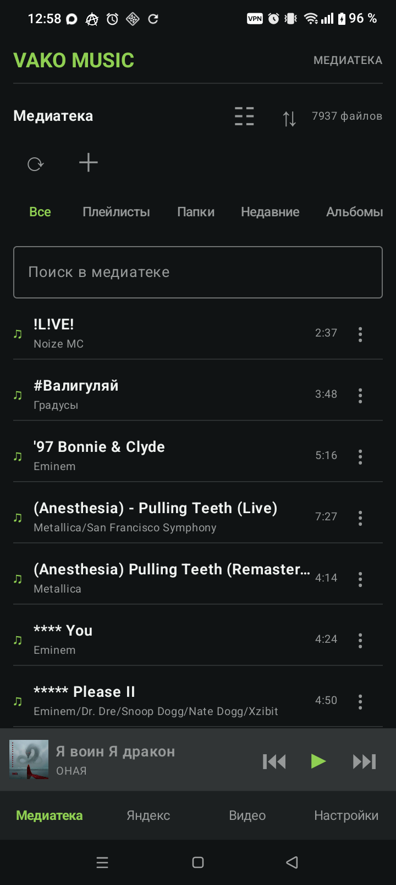
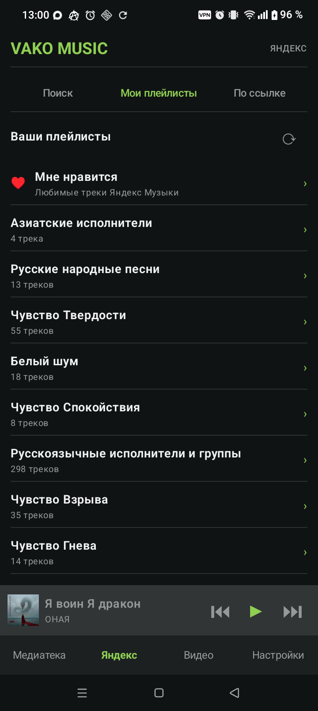
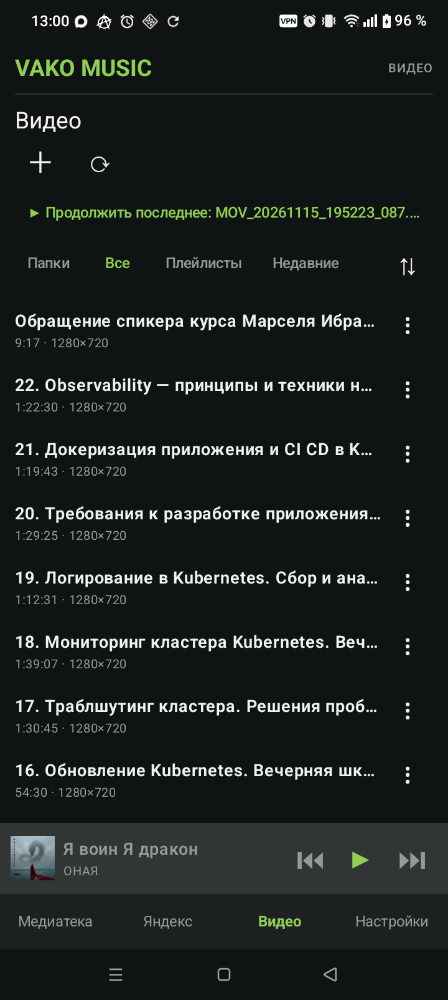
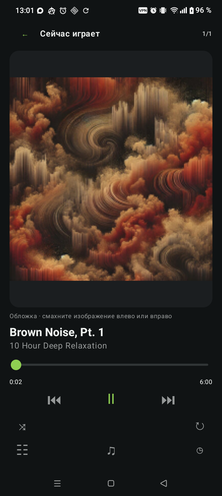

# Vako Music

Компактный музыкальный и видеоплеер для Android 10 и новее. Он собирает локальные файлы в медиатеку, позволяет ходить по папкам как в файловом менеджере и, по желанию пользователя, подключаться к Яндекс Музыке. Локальные файлы и каталог Яндекса находятся в отдельных вкладках; видеомодуль тоже можно отключить.

**Первый публичный релиз — 0.0.1.** Номера 0.5.0–0.18.0 в [истории разработки](docs/DEVELOPMENT_HISTORY.md) относились к внутренним прототипам. `versionCode` равен 19, чтобы установленная тестовая сборка могла обновиться без потери данных при совпадении подписи APK.

## Как выглядит приложение

| Медиатека | Яндекс Музыка | Видеотека | Плеер |
| :---: | :---: | :---: | :---: |
|  |  |  |  |

[Галерея экранов](docs/SCREENSHOTS.md) показывает плейлисты, поиск, настройки цветов и визуализации. На снимках — реальные пользовательские медиатеки; названия композиций и плейлистов приведены только как примеры.

## Что можно делать

### Слушать локальную музыку

- После стандартного разрешения Android приложение находит аудио в памяти телефона и на карте памяти. Отдельный файл можно добавить через системный выбор файла.
- Медиатека показывает **все треки**, собственные **плейлисты**, **недавние**, **альбомы**, **исполнителей**, **жанры** и **избранное**. Доступны поиск и сортировка.
- В разделе **«Папки»** можно открывать накопитель, переходить в папки и подпапки и возвращаться на уровень выше. При необходимости можно показать треки из всех вложенных папок, воспроизвести папку или создать из неё плейлист.
- Долгое нажатие включает выбор нескольких треков для массовых действий. Контекстные меню позволяют добавлять треки в очередь и плейлисты, а также переименовывать, переносить и отправлять локальные файлы. Для папок предусмотрены действия с содержащимися в них аудиофайлами. Android отдельно подтверждает изменение файлов, принадлежащих другим приложениям.

### Управлять воспроизведением

- Мини-плеер остаётся внизу экрана; нажатие открывает полноэкранный плеер с перемоткой, очередью, повтором, перемешиванием, таймером сна и эквалайзером.
- Обложка и шесть визуализаций переключаются свайпом влево или вправо. Для визуализации Android отдельно запрашивает разрешение на аудиозапись, поскольку используется системный аудиосеанс.
- Музыка продолжает играть в фоне. Пауза, переход между треками и перемотка доступны из системной шторки и с экрана блокировки.
- Очередь можно менять перетаскиванием, сохранять как именованный список и восстанавливать после перезапуска приложения. Доступны команды «играть следующим» и «добавить в очередь».

### Подключить Яндекс Музыку

- Модуль включается в настройках и работает с OAuth-токеном аккаунта. Можно искать треки и исполнителей, открывать трек, альбом или плейлист по ссылке.
- **«Мои плейлисты»** включают «Мне нравится». Можно просматривать свои подборки, переименовывать их, добавлять и убирать треки. Команда «Добавить в плейлист…» открывает выбор нужного плейлиста.
- Доступные аккаунту треки и целые плейлисты можно загружать в обычные аудиофайлы в общую папку `Music/MusicDownloader`, чтобы они появлялись в локальной медиатеке и других плеерах. Формат выбирается в настройках: MP3 или FLAC при доступности. Наличие отдельных треков и форматов зависит от аккаунта, подписки и ответа сервиса.

### Смотреть локальное видео

- Видеомодуль показывает общий список, папки и подпапки, недавние видео и собственные видеоплейлисты. Можно продолжить последний просмотр с сохранённой позиции.
- Плеер поддерживает внешние субтитры, скорость воспроизведения, ориентацию, режимы размера изображения, масштабирование щипком и системную «картинку в картинке».
- Удержание экрана временно ускоряет видео до 2×; свайпы меняют яркость **окна плеера** слева, громкость **видео** справа и позицию воспроизведения по горизонтали. Для уровней яркости и громкости можно включить или выключить экранные шкалы. Точность перехода к кадру зависит от файла и декодера.
- Видео и папки можно добавлять в плейлисты, переименовывать, копировать, переносить, отправлять и удалять; есть массовый выбор. Изменение чужих медиафайлов подтверждает Android.

### Настроить приложение под себя

- Скрыть ненужные разделы, включая Яндекс Музыку и видео, выбрать начальный экран и плотность строк медиатеки.
- Выбрать белую, серую или чёрную основу и один из восьми цветов элементов. Для своей палитры можно ввести HEX-цвета фона, панелей, текста и акцента.
- Настроить сортировку, вид обложек, поведение нажатия на трек, параметры воспроизведения и видео.

## Установка

Скачайте `Vako-Music-v0.0.1.apk` на странице [Releases](https://github.com/ValentS1997/Vako-Music/releases/tag/v0.0.1). Android может попросить разрешить установку из выбранного источника. Инструкции по проверке подписи и сборке из исходников находятся в [docs/RELEASE_SIGNATURE.md](docs/RELEASE_SIGNATURE.md) и [docs/BUILDING.md](docs/BUILDING.md).

Обновление ранее установленного тестового APK без удаления возможно только при совпадении сертификата подписи. Если Android требует переустановку, сначала сохраните важные локальные данные приложения.

## Интеграция с Яндекс Музыкой и авторство

Клиент Яндекс Музыки и загрузчик аудио Vako Music **переработаны для Android на основе проекта [vladimir120307-droid/yandex-music-downloader](https://github.com/vladimir120307-droid/yandex-music-downloader)**, опубликованного под лицензией MIT. Авторство и полный текст лицензии сохранены в [THIRD_PARTY_LICENSE.md](THIRD_PARTY_LICENSE.md); остальные сторонние зависимости перечислены в [THIRD_PARTY_NOTICES.md](THIRD_PARTY_NOTICES.md).

Это независимая реализация взаимодействия с сервисом, **не официальный SDK Яндекса**. Методы сервиса, используемые для загрузки и изменения плейлистов, не имеют обещанной совместимости: после изменений Яндекс Музыки может потребоваться обновление приложения. Vako Music не связано с Яндексом. Используйте загрузку с учётом условий сервиса и прав на музыку.

OAuth-токен хранится в зашифрованном виде с ключом Android Keystore на устройстве; пароль Яндекса приложение не запрашивает. Приложение не содержит собственного сервера и аналитики. Подробнее о разрешениях и сетевых обращениях — в [политике конфиденциальности](docs/PRIVACY.md). О проблемах безопасности сообщайте по [SECURITY.md](SECURITY.md), не публикуя токены и личные данные в issue.

## Разработка и участие

Проект написан на Kotlin и Jetpack Compose. Структура и известные ограничения описаны в [архитектуре](docs/ARCHITECTURE.md) и [CHANGELOG.md](CHANGELOG.md). Для сборки требуются JDK 17, Android SDK Platform 34 и Gradle Wrapper:

```bash
./gradlew assembleDebug lintDebug
```

Issue и pull request приветствуются; порядок работы — в [CONTRIBUTING.md](CONTRIBUTING.md). Материалы исследования интерфейсов и история прототипов находятся в [документации](docs/DEVELOPMENT_HISTORY.md).

При разработке Vako Music использовались инструменты ИИ для написания, анализа и переработки кода и документации. Решения по функциям и публикации принимает владелец проекта; результаты проверяются сборкой и испытаниями на устройстве. Подробнее — в [docs/AI_USAGE.md](docs/AI_USAGE.md).

## Лицензия

Собственный код Vako Music предоставлен по [PolyForm Noncommercial License 1.0.0](LICENSE): разрешены некоммерческие использование, изменение и распространение с соблюдением условий лицензии. **Коммерческое использование требует отдельного разрешения правообладателя.** Исходный код доступен публично, но эта лицензия не является open source по определению OSI. У сторонних частей сохраняются собственные лицензии.
