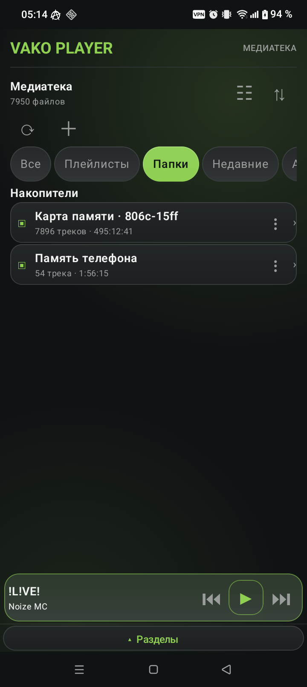
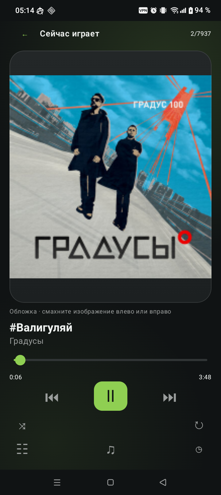
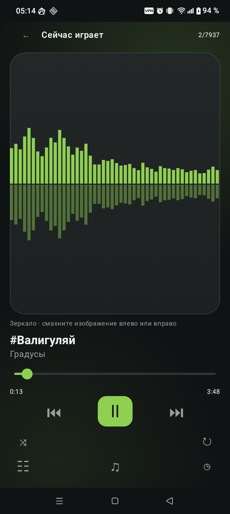
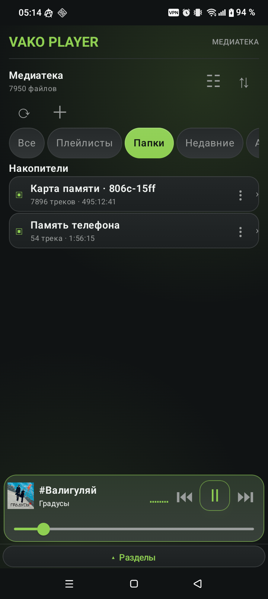
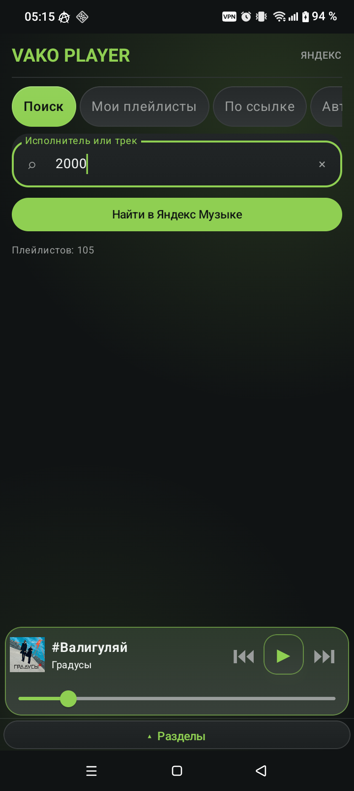
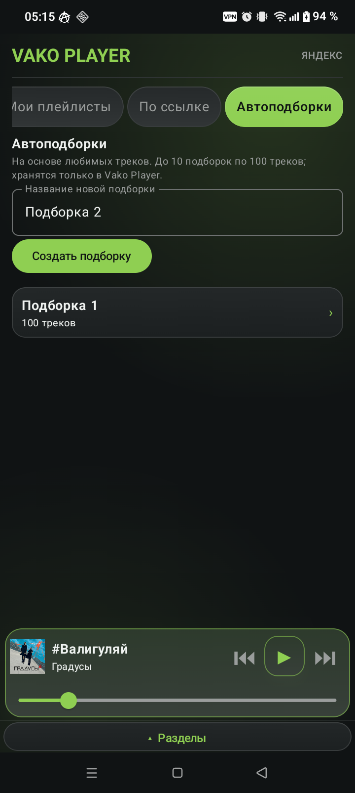
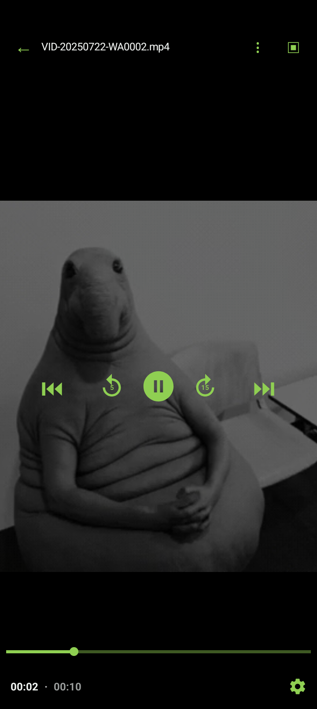
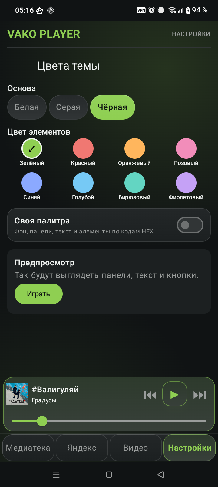
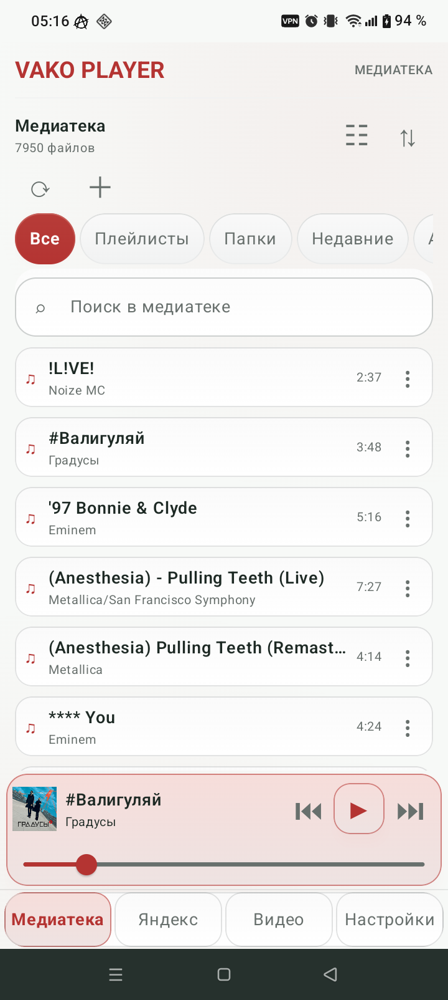
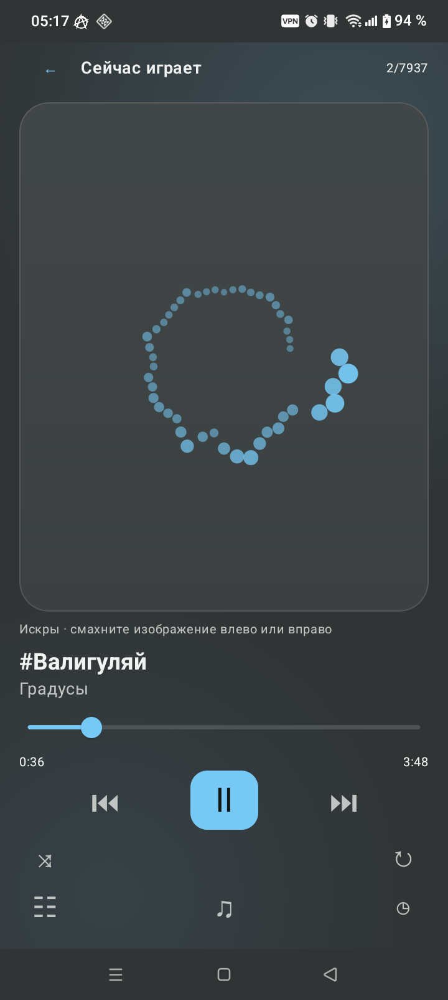

# Экраны Vako Player 0.0.2

Снимки сделаны на Android-смартфоне с установленной тестовой сборкой 0.0.2. Названия треков, видео и плейлистов принадлежат медиатеке пользователя.

## Локальная медиатека

| Все треки | Плейлисты | Накопители |
| :---: | :---: | :---: |
|  |  |  |

## Воспроизведение

| Обложка | Визуализация «Зеркало» | Визуализация «Искры» |
| :---: | :---: | :---: |
|  |  |  |

| Мини-плеер с прогрессом |
| :---: |
|  |

## Яндекс Музыка

| Мои плейлисты | Поисковый запрос | Результаты поиска | Автоподборки |
| :---: | :---: | :---: | :---: |
|  |  |  |  |

## Видео

| Видеоплеер |
| :---: |
|  |

## Темы

| Тёмная тема | Светлая тема | Серая тема |
| :---: | :---: | :---: |
|  |  |  |

[Вернуться к описанию проекта](../README.md).
