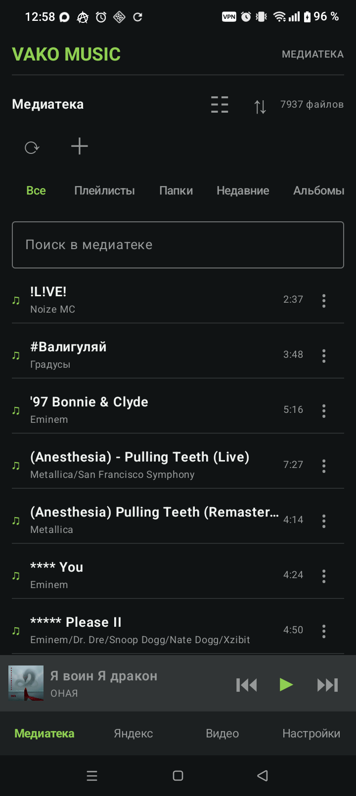
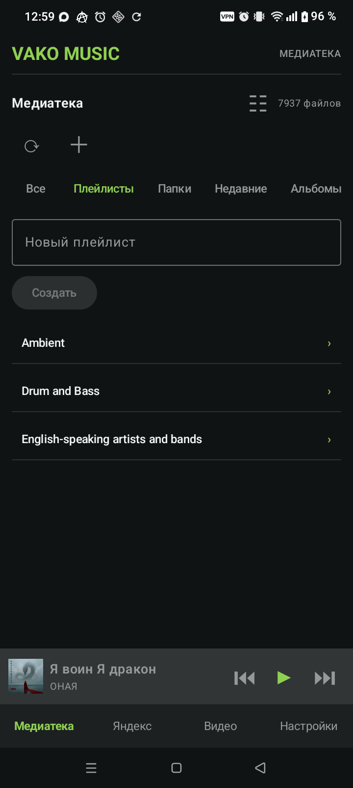
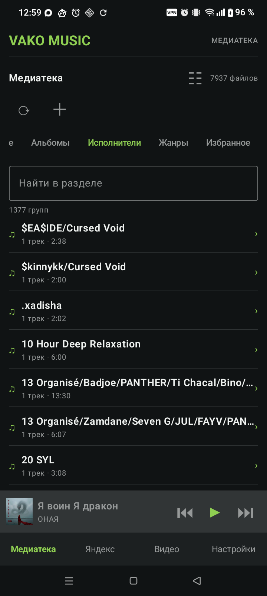
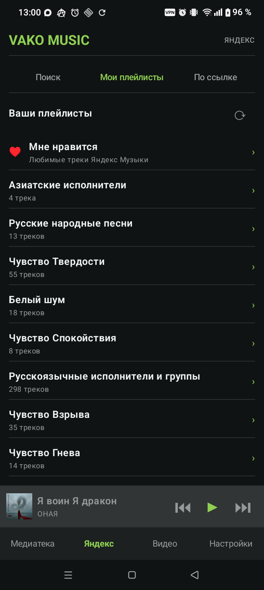
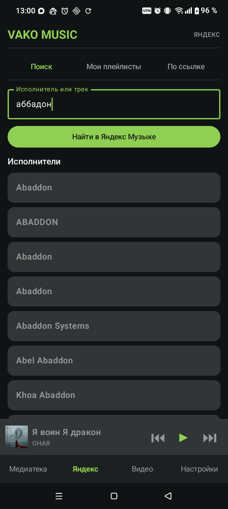
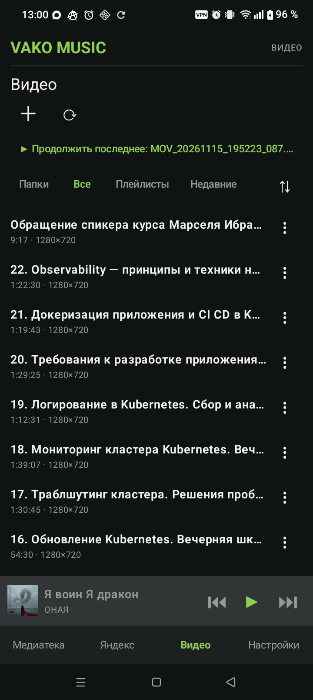
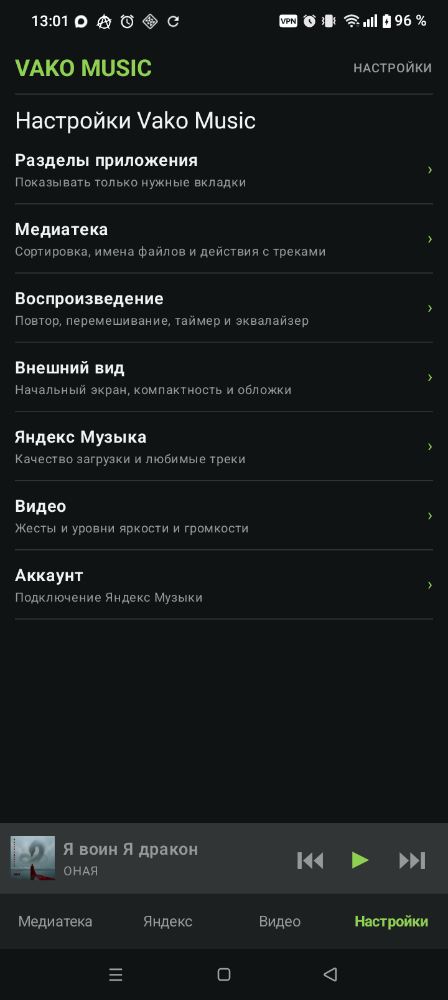
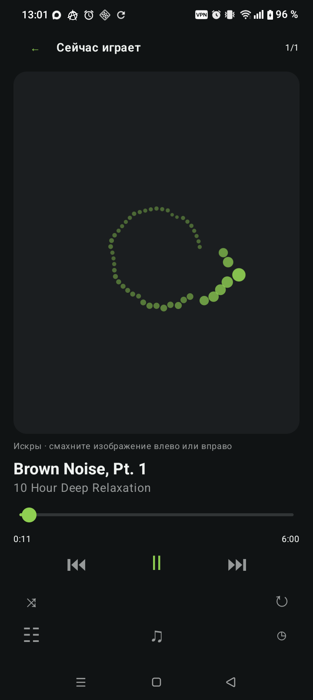

# Экраны Vako Music 0.0.1

Снимки сделаны на Android-смартфоне. Они показывают рабочий интерфейс первой публичной версии; названия треков, видео и плейлистов принадлежат тестовой медиатеке пользователя.

| Локальная музыка | Локальные плейлисты | Исполнители |
| :---: | :---: | :---: |
|  |  |  |

| Плейлисты Яндекс Музыки | Поиск исполнителей | Локальное видео |
| :---: | :---: | :---: |
|  |  |  |

| Настройки | Цвета темы | Полноэкранный плеер |
| :---: | :---: | :---: |
|  |  |  |

| Спектр | Искры |
| :---: | :---: |
|  |  |

[Вернуться к описанию проекта](../README.md).
